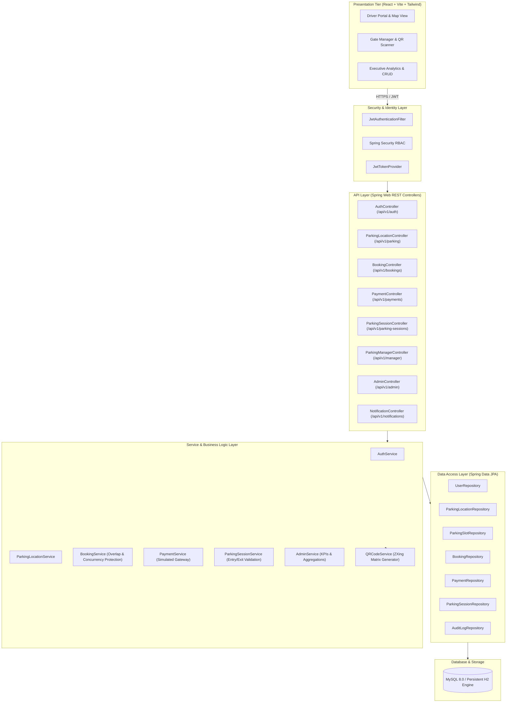
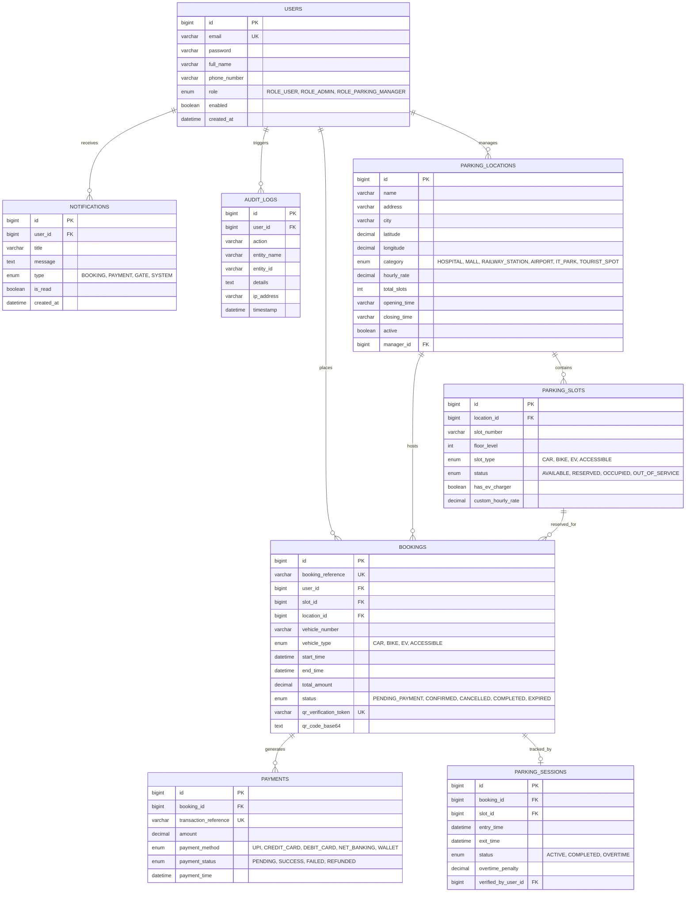

# 🚗 Smart Parking Management System (SPMS)
### *Find. Book. Park Smartly at Popular Places.*

A production-grade, full-stack **Smart Parking Management System** built with **Spring Boot 3.x (Java 21/25)**, **React (Vite)**, **Tailwind CSS**, and **MySQL 8.0**. Designed directly from the reference architectural blueprint to deliver real-time slot availability, interactive Leaflet geo-mapping, visual parking bay selection, transactional reservation concurrency controls, simulated payment gateways, and contactless QR-code gate entry/exit verification.

---

## 📸 System Highlights & Reference Architecture Alignment

| Feature Category | Implementation Details |
| :--- | :--- |
| **Backend Architecture** | Spring Boot 3.3.4, Spring Security, JWT 0.12.6, Spring Data JPA, Hibernate, ZXing QR Engine, OpenAPI/Swagger |
| **Frontend UI/UX** | React 18, Vite, Tailwind CSS, Lucide React, Leaflet Maps, Recharts Analytics, Canvas Confetti |
| **Database Engine** | MySQL 8.0 InnoDB + Automatic Zero-Config Persistent H2 Fallback (`MODE=MySQL`) |
| **Role-Based Access Control** | `ROLE_USER`, `ROLE_PARKING_MANAGER`, `ROLE_ADMIN` enforced at controller & service layers |
| **Concurrency & Integrity** | `Isolation.SERIALIZABLE` booking locks, server-side fee calculations, duplicate scan prevention |
| **Popular Facility Coverage** | Hospitals, Shopping Malls, Railway Stations, International Airports, IT Tech Parks, Tourist Landmarks |

---

## 🏛️ System Architecture

The application adheres to clean hexagonal multi-tier architecture matching the system blueprint:



---

## 📊 Database Entity-Relationship (ER) Diagram



---

## 🗺️ User Journey (7-Step Interactive Workflow)

```
[1. Search Location] ──> [2. Find Nearby Parking] ──> [3. Check Availability] ──> [4. Book Slot]
   (City, Name, Type)       (Interactive Map + List)    (Color-Coded Bay Grid)     (Duration & Vehicle)
                                                                                         │
[7. Park & Exit Gate] <── [6. QR Pass Generated] <── [5. Complete Payment] <────────────┘
 (Manager Camera Scan)     (Contactless Digital QR)    (Simulated Gateway)
```

1. **Search Location**: Drivers filter by category (Hospital, Mall, Airport, IT Park, Railway, Landmark), city, or vehicle type.
2. **Find Nearby Parking**: Switch between an interactive OpenStreetMap Leaflet view and modern card list view with real-time slot counters and distance metrics.
3. **Check Live Availability**: Navigate into the facility bay grid with real-time status indicators (🟢 Available, 🔴 Occupied, 🟡 Reserved, ⚪ Maintenance).
4. **Book Slot**: Select an eligible bay, specify vehicle plate number (`KA-05-AB-9999`), and adjust the duration slider.
5. **Simulated Payment**: Checkout via simulated UPI, Debit/Credit Card, or NetBanking with instant transaction receipts.
6. **QR Code Generated**: Receive an official digital parking ticket pass with a high-resolution scannable QR matrix, printable voucher, and 1-click Google Maps navigation.
7. **Park & Exit Gate Verification**: On arrival, the parking manager scans the QR pass using their device camera or manual verification token, unlocking the gate barrier and recording exact timestamps.

---

## 👥 Role Matrix & Pre-Seeded Demo Credentials

The platform includes convenient **1-Click Demo Login** buttons on the Login page for hassle-free evaluation:

| Role | Email | Password | Primary Capabilities |
| :--- | :--- | :--- | :--- |
| **`ROLE_USER`** *(Driver)* | `user@smartparking.com` | `User@123` | Search locations, view slot bay map, reserve slots, simulate payment, view digital QR pass, cancel reservations. |
| **`ROLE_USER`** *(Driver 2)* | `rahul@smartparking.com` | `User@123` | Second registered driver for concurrency and multi-user testing. |
| **`ROLE_PARKING_MANAGER`** | `manager@smartparking.com` | `Manager@123` | Assigned to **Phoenix Marketcity**. Access live occupancy meter, gate scanner (camera + manual token), mark entry/exit. |
| **`ROLE_PARKING_MANAGER`** *(Apollo)* | `manager2@smartparking.com` | `Manager@123` | Assigned to **Apollo Multispecialty Hospital**. Facility-restricted manager portal. |
| **`ROLE_ADMIN`** | `admin@smartparking.com` | `Admin@123` | Executive analytics (Recharts), facility CRUD, slot inventory, user accounts, system audit trail. |

---

## 🚀 Quickstart Guide

### Prerequisites
- **Java**: JDK 21 or later (`java -version`)
- **Node.js**: v18.0.0 or later (`node -v`)
- **Maven**: 3.8+ (or use IDE Maven wrapper)
- **MySQL**: 8.0+ *(Optional; system defaults to persistent zero-config H2 file mode with full MySQL dialect compatibility)*

---

### Step 1: Start the Spring Boot Backend

Open your terminal or PowerShell in the project directory:

```bash
cd backend
mvn spring-boot:run
```

- Backend runs on: **`http://localhost:8080`**
- Swagger / OpenAPI UI: **`http://localhost:8080/swagger-ui.html`**
- OpenAPI JSON Spec: **`http://localhost:8080/api-docs`**
- Embedded Database Console: **`http://localhost:8080/h2-console`** *(JDBC URL: `jdbc:h2:file:./data/smartparking`, User: `sa`, Password: blank)*

> **Note**: On the very first run, `DataInitializerService` automatically seeds 5 user accounts, 6 major parking facilities, and dozens of pre-configured slots.

---

### Step 2: Start the React Frontend

Open a second terminal window:

```bash
cd frontend
npm install
npm run dev
```

- Frontend runs on: **`http://localhost:5173`**
- Built with Vite for instant hot-module-reloading.

---

### Step 3: (Optional) Connecting to MySQL 8.0 / MySQL Workbench

If you want to run against a standalone MySQL 8.0 server:

1. Open **MySQL Workbench** and execute `database/schema.sql`.
2. Execute `database/seed-data.sql` to populate initial demo data.
3. Start the backend with the `mysql` profile activated:

**PowerShell (Windows):**
```powershell
$env:SPRING_PROFILES_ACTIVE="mysql"
$env:SPRING_DATASOURCE_USERNAME="root"
$env:SPRING_DATASOURCE_PASSWORD="YOUR_MYSQL_PASSWORD"
cd backend
mvn spring-boot:run
```

**Bash / Linux / macOS:**
```bash
export SPRING_PROFILES_ACTIVE=mysql
export SPRING_DATASOURCE_USERNAME=root
export SPRING_DATASOURCE_PASSWORD=YOUR_MYSQL_PASSWORD
cd backend
mvn spring-boot:run
```

---

## 🧪 Running Automated Unit & Integration Tests

The backend includes a comprehensive test suite covering transactional overlap collision detection, price calculation integrity, and booking workflows:

```bash
cd backend
mvn test
```

Expected output:
```
[INFO] Tests run: 5, Failures: 0, Errors: 0, Skipped: 0
[INFO] BUILD SUCCESS
```

---

## 📡 REST API Catalog (`/api/v1`)

### 1. Authentication (`/api/v1/auth`)
- `POST /api/v1/auth/register` — Register a new driver account.
- `POST /api/v1/auth/login` — Authenticate and receive a signed JWT token.
- `GET  /api/v1/auth/me` — Retrieve current authenticated user profile.

### 2. Parking Locations & Slots (`/api/v1/parking`)
- `GET /api/v1/parking` — Search facilities with filters (city, query, category, minAvailableSlots).
- `GET /api/v1/parking/{id}` — Retrieve facility details and operating hours.
- `GET /api/v1/parking/{id}/slots` — Retrieve slot bay grid and live statuses.
- `GET /api/v1/parking/{id}/availability` — Real-time availability breakdown by vehicle type.

### 3. Bookings (`/api/v1/bookings`)
- `POST /api/v1/bookings` — Reserve a slot with validation and price calculation.
- `GET  /api/v1/bookings/my` — Get logged-in user's bookings with filter tabs.
- `GET  /api/v1/bookings/{id}` — Get booking details and base64 QR code pass.
- `POST /api/v1/bookings/{id}/cancel` — Cancel an active reservation.

### 4. Payments (`/api/v1/payments`)
- `POST /api/v1/payments/create-order` — Initialize payment order for booking.
- `POST /api/v1/payments/confirm` — Confirm simulated payment and activate QR pass.
- `GET  /api/v1/payments/my` — Retrieve user payment transaction history.

### 5. Gate Verification & Sessions (`/api/v1/parking-sessions`)
- `POST /api/v1/parking-sessions/verify` — Inspect QR token prior to barrier opening.
- `POST /api/v1/parking-sessions/entry` — Record vehicle gate entry and change slot to OCCUPIED.
- `POST /api/v1/parking-sessions/exit` — Record vehicle gate exit, assess overtime, and free slot.

### 6. Parking Manager (`/api/v1/manager`)
- `GET /api/v1/manager/facility` — Get assigned parking facility metrics and occupancy.
- `PUT /api/v1/manager/slots/{slotId}/status` — Update individual slot maintenance status.

### 7. Admin & Analytics (`/api/v1/admin`)
- `GET    /api/v1/admin/dashboard` — Executive KPI summary (occupancy, revenue, distribution).
- `POST   /api/v1/admin/locations` — Create a new parking facility.
- `PUT    /api/v1/admin/locations/{id}` — Update facility details or toggle active status.
- `POST   /api/v1/admin/slots` — Add a new parking bay.
- `GET    /api/v1/admin/users` — List and manage user accounts and roles.
- `GET    /api/v1/admin/bookings` — Supervise all system reservations.
- `GET    /api/v1/admin/audit-logs` — Review system security audit trail.

---

## 🛡️ Concurrency & Double-Booking Protection

A critical requirement of any production smart parking platform is ensuring two users cannot reserve the same parking slot for overlapping time windows.

In `BookingService.java`:
1. **Transaction Isolation**: Reservation requests execute inside `@Transactional(isolation = Isolation.SERIALIZABLE)`.
2. **Overlap Query**:
   ```sql
   SELECT b FROM Booking b 
   WHERE b.slot.id = :slotId 
     AND b.status IN ('CONFIRMED', 'PENDING_PAYMENT')
     AND (b.startTime < :endTime AND b.endTime > :startTime)
   ```
3. **Pessimistic Slot Status Validation**: Rejects reservations if slot is `OCCUPIED` or `OUT_OF_SERVICE`.
4. **Server-Side Price Calculation**: Price is calculated solely on backend using `Duration.between(start, end)` multiplied by `effectiveHourlyRate`. Frontend price submissions are never trusted.

---

## 📁 Repository Directory Structure

```
smart-parking/
├── backend/                              # Spring Boot 3.3.4 Application
│   ├── data/                             # Persistent H2 file storage directory
│   ├── src/
│   │   ├── main/
│   │   │   ├── java/com/smartparking/
│   │   │   │   ├── config/               # Security, OpenAPI, CORS configuration
│   │   │   │   ├── controller/           # Versioned REST Controllers (/api/v1/*)
│   │   │   │   ├── dto/                  # Request / Response Transfer Objects
│   │   │   │   ├── entity/               # JPA Entities (JPA Annotations & Indexes)
│   │   │   │   ├── enums/                # Role, SlotType, SlotStatus, BookingStatus
│   │   │   │   ├── exception/            # GlobalExceptionHandler & Domain Exceptions
│   │   │   │   ├── repository/           # Spring Data JPA Repositories
│   │   │   │   ├── security/             # JWT Provider, AuthFilter, UserDetails
│   │   │   │   └── service/              # Transactional Business Services & QR Engine
│   │   │   └── resources/
│   │   │       ├── application.properties
│   │   │       └── application-mysql.properties
│   │   └── test/                         # Unit tests (BookingServiceTest)
│   ├── pom.xml
│   └── .env.example
├── frontend/                             # React 18 + Vite + Tailwind CSS Application
│   ├── src/
│   │   ├── components/                   # Navbar, Footer, ProtectedRoute
│   │   ├── context/                      # AuthContext (Role Switcher), NotificationContext
│   │   ├── pages/
│   │   │   ├── LandingPage.jsx           # Hero, Journey, Categories, Benefits
│   │   │   ├── SearchParkingPage.jsx     # Leaflet Map + Grid/List View
│   │   │   ├── ParkingDetailsPage.jsx    # Visual Color-Coded Slot Bay Grid
│   │   │   ├── BookingConfirmationPage.jsx # Reservation Summary & Validation
│   │   │   ├── PaymentPage.jsx           # Simulated Payment Gateway + Confetti
│   │   │   ├── BookingTicketPage.jsx     # Base64 Scannable QR Pass & Print
│   │   │   ├── MyBookingsPage.jsx        # User Reservation History
│   │   │   ├── UserDashboardPage.jsx     # Driver Portal & Active Passes
│   │   │   ├── AdminDashboardPage.jsx    # Executive Analytics (Recharts)
│   │   │   ├── AdminLocationsPage.jsx    # Facility CRUD Management
│   │   │   ├── AdminSlotsPage.jsx        # Slot Bay Inventory Management
│   │   │   ├── AdminBookingsPage.jsx     # Global Booking Supervision
│   │   │   ├── AdminUsersPage.jsx        # User Account Role Management
│   │   │   ├── AdminAuditLogsPage.jsx    # Security Audit Trail
│   │   │   ├── ManagerDashboardPage.jsx  # Facility Manager Portal & Live Occupancy
│   │   │   ├── ManagerScannerPage.jsx    # Camera QR Reader + Gate Barrier Trigger
│   │   │   ├── ProfilePage.jsx           # User Profile & Security Settings
│   │   │   ├── AccessDeniedPage.jsx      # HTTP 403 Forbidden Screen
│   │   │   └── NotFoundPage.jsx          # HTTP 404 Route Screen
│   │   ├── services/                     # Axios API Client with JWT Interceptors
│   │   ├── App.jsx                       # React Router v6 Configuration
│   │   ├── index.css                     # Tailwind CSS Directives & Custom Utilities
│   │   └── main.jsx
│   ├── package.json
│   ├── vite.config.js
│   ├── tailwind.config.js
│   └── .env.example
├── database/                             # Database Schema & Data Assets
│   ├── schema.sql                        # Production MySQL 8.0 DDL Script
│   ├── seed-data.sql                     # Realistic Seed Data Script
│   └── README.md                         # MySQL Workbench Configuration Guide
├── .gitignore
├── .env.example                          # Root Environment Configuration Template
└── README.md                             # Comprehensive Project Documentation
```

---

## 🎓 College Major Project & Placement Interview Guide

When presenting this project to evaluators or interviewers, highlight these key engineering decisions:

1. **Enterprise Layering**: Clean separation of concerns (Controller -> Service -> Repository -> Entity) ensures scalability and high cohesion.
2. **Security by Design**: Passwords hashed using **BCrypt** (cost factor 10); API endpoints protected by stateless **JWT (HMAC-SHA256)** tokens; Method-level `@PreAuthorize` security checks prevent privilege escalation.
3. **Defensive Concurrency**: Double booking is eliminated via database-level serialization and programmatic overlap query checks.
4. **QR Code Verification Lifecycle**: The QR code contains an opaque, cryptographically random verification token (not sensitive PII) that transitions state from `CONFIRMED` -> `ACTIVE` (at entry scan) -> `COMPLETED` (at exit scan). Duplicate scans are blocked with explicit audit logs.
5. **Zero-Friction Evaluation**: Includes pre-configured persistent H2 mode with pre-seeded demonstration data, so any evaluator can run the system with zero database setup overhead, while retaining full compatibility with MySQL 8.0.

---

## 📄 License
This project is developed for educational and portfolio demonstration purposes. All rights reserved.
